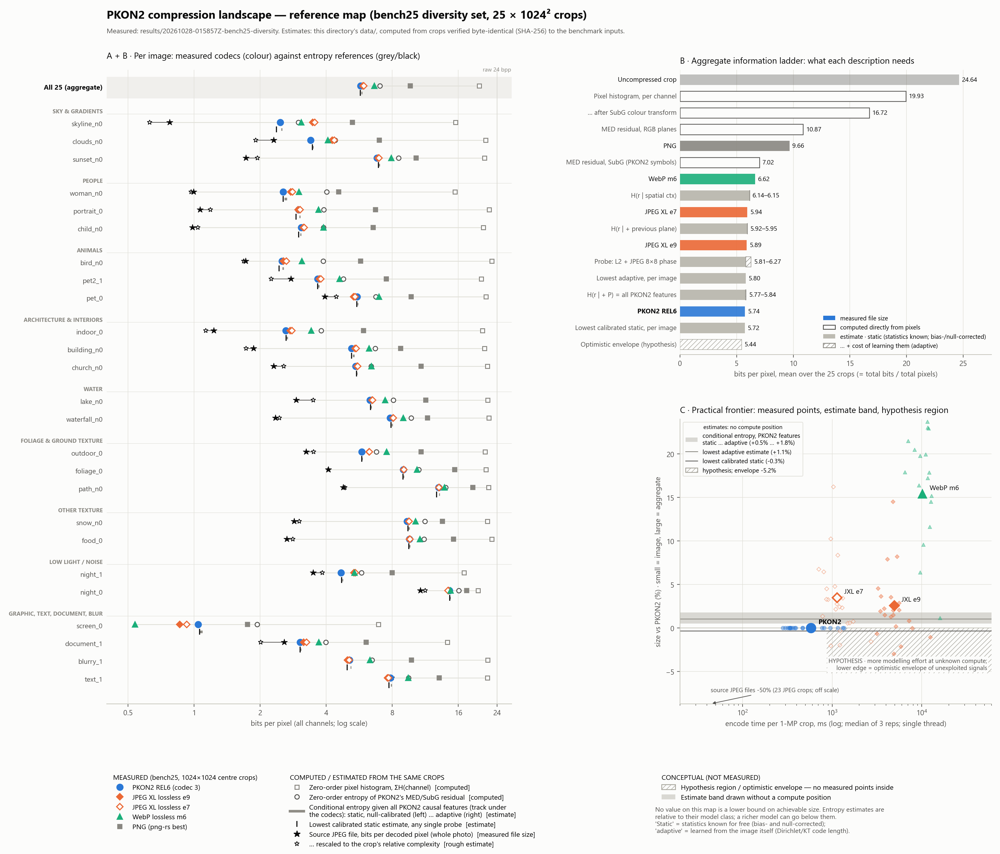

# PKON2 — Shannon entropy map and practical compression frontier

Results dir: `results/20261028-030932Z-entropy-map`. **Analysis only.** No encoder, decoder, benchmark or test was run; no production code was changed. Every measured number comes from the existing benchmark `results/20261028-015857Z-bench25-diversity` (PKON2 REL6 codec 3, JPEG XL e7/e9, WebP m6, PNG on 25 centre crops of 1024 × 1024). Every entropy number is computed offline from those same crops.



| figure | layer | what it shows |
|---|---|---|
| `fig1_reference_map` | A + B + C | **The map.** Per image: measured codecs against entropy references. Aggregate information ladder. Size vs encode time with estimate bands and the hypothesis region. |
| `fig2_information_landscape` | B | Spatial conditioning on the G plane, cross-channel redundancy per image, and bits per coded plane. |
| `fig3_frontier_compute` | C | Size vs encode time and vs decode time, per image and aggregate. |
| `fig4_headroom_indicators` | C | Seven separate indicators of the gap per image. They are not additive components. |

Each figure is provided as PNG (200 dpi), SVG and PDF. Every plotted value is in `data/` (see §10).

## Summary

**Observed:**
- **Where PKON2 stands.**
  - PKON2 measures **5.739 bpp** in aggregate, smaller than JXL e9 (5.888), JXL e7 (5.940), WebP m6 (6.624) and PNG (9.662).
  - It produces the smallest file on 18 of 25 images.
- **PKON2 is not losing information that its own features carry.** For every image I estimated the conditional entropy of PKON2's residual symbols given all of PKON2's causal context features.
  - The aggregate band is **5.769 bpp (static, bias- and null-corrected) to 5.841 bpp (adaptive)**. PKON2 measures 5.739 bpp, below both ends.
  - Per image, PKON2 is below the adaptive end on 25/25 images and below the static end on 20/25. The other 5 exceed it by at most 1.0%.
- **There is structure that PKON2's features do not use.** Net of matched random-context controls, the information is:
  - per-plane choice between MED and a local least-squares predictor: −2.4% of PKON2's bits;
  - position on the source JPEG's 8×8 grid: −1.9%;
  - pixel parity: −0.9%.
  - Each figure is measured on its own, and how much they overlap is unknown. Summed as if independent, they give an optimistic envelope of **5.44 bpp (−5.2%)**, ranging from −0.6% to −19% per image.
- **On the images where JPEG XL beats PKON2, the predictor probe finds structure on all but one.** These are portrait_0, pet_0, blurry_1, text_1 and path_n0 (a near-tie). The exception is night_0, where no probe finds signal. On screen_0, WebP's 48.5% win matches non-local exact repetition (35% of the pixels that MED mispredicts) that no local-context entropy reference can see.
- **The largest remaining structure is provenance, not statistics.**
  - 23 of the 25 crops are decoded JPEGs, and 22 of those still carry the source JPEG's quantisation lattice (aligned statistic 0.50–0.90 vs −0.18 to −0.02 on a shifted grid).
  - The source JPEG files spend **3.01 bpp** (whole-photo average) against PKON2's 5.97 bpp on the same 23 crops (−50%).
  - Recovering this requires reproducing the source decoder bit-exactly. No entropy estimate in this map captures it.
- **Compute.** PKON2's encode is the fastest of the five configurations, but its decode is the slowest (600 ms per 1-MP crop vs 448–487 for JXL, 119 for WebP). The decode cost comes with the symmetric context-mixing design. bench25 has a single PKON2 configuration, so there is no measured PKON2 rate–compute curve.

**Interpretation.** On this set, PKON2's remaining headroom against estimates built from its own representation is small: within about ±1% per image, which is the size of the estimators' own uncertainty. The apparent opportunities lie in information outside PKON2's feature set. Two kinds are small and modelable: adaptive prediction and position contexts, a few percent and partly overlapping. One is large and brittle: JPEG provenance, around 50% on JPEG-origin input.

## 1. Data and conditions

- **Images.** These are the 25 bench25 images: 23 JPEG-origin RGB and 2 PNG-origin RGBA (blurry_1, screen_0). Both alpha planes are constant 255, which I re-verified here. Every number refers to the **1024 × 1024 centre crops**, never the full photographs. The scene groups in this report reproduce the report's category groups, with food_0 and snow_n0 added as "Other texture".
- **Exact inputs.** Python's JPEG decoder does not reproduce the benchmark's Rust `image`-crate decode: only 2/25 crops matched. So `src/bin/entmap_export.rs` (a new, export-only binary) loads each source with the benchmark's own `Canonical::load` + `center_crop(1024)` and asserts the crop SHA-256 recorded in `manifest_pre_encode.json`. **25/25 crops matched.** The crops were written to a scratch directory, not into this results dir (80 MB, and reproducible).
- **Implementation check.** My numpy MED reproduces the harness descriptors (`med_mae_g`, `med_zero_frac_g`) exactly on 25/25 images (difference 0.0). PKON2 features (neighbour border rules, MED, GAP, gradient predictor, activity, err-energy, prev-plane buckets, sign classes, P) were re-derived from `src/pkon2.rs` / `src/pkonrel.rs`.
- **Measured values** were copied from bench25 `per_image.csv` / `results.json`: stored bytes including PKON2's 24-byte header, and median times of 3 reps. Timing caveats carry over: JXL and WebP were driven through the ffmpeg CLI (no-op floor 41–58 ms), PKON2 and PNG in-process, single thread, on an i7-1185G7 laptop.
- **Units.** bpp means bits per pixel with all channels counted. "Aggregate" means total bits / total pixels. All crops have equal size, so this is the mean of the per-image bpp.

## 2. Symbols, distributions and estimators

Every estimate is a property of a stated *model class*. None of them is a lower bound on achievable lossless size: a richer model can go below any of them, and the true entropy rate of these images is unknown.

| quantity | symbol and empirical distribution | conditioning | kind |
|---|---|---|---|
| ΣH0(channel) | sample value 0–255, histogram per channel over 1,048,576 px | none: i.i.d. pixels, independent channels | computed directly |
| H0 after SubG | planes G, R−G+128, B−G+128 (mod 256) | none | computed directly |
| I(R;G), I(B;G), I(R;B) | 256 × 256 joint histogram of two channels | pairwise | plug-in estimate, slight upward bias |
| H(R,G,B) | joint colour triple | none | plug-in, **undersampled**: ceiling log2(1,048,576) = 20 bits; 2,005–257,215 distinct colours per crop |
| H(G\|W), H(G\|W,N) | G value given raw left / left+up G values (256 / 65,536 contexts) | spatial, raw neighbours | estimate band |
| H0 MED residual | zigzag residual z = zz((x − MED) mod 256), per plane, RGB or SubG domain | none | computed directly; the SubG version is exactly PKON2's symbol stream |
| H(z \| L1) | z coded as class (bit length of \|r\|, 9 symbols) + mantissa + sign, PKON2's binarisation | L1 = activity (8) × neighbour residual energy (8) × MED branch (3) for class; W/N/NE residual signs (27) × class (4) for sign; activity for mantissa | estimate band |
| H(z \| L2) | as above | L1 + previous plane's residual magnitude (4) and sign (3) | estimate band |
| H(z \| L3) | as above | L2 + P = GAP−MED × grad−MED disagreement (49), i.e. all PKON2 context features | estimate band |
| probes | as above | L2 × pixel parity (4); L2 × 8×8 phase on the source JPEG grid (64); MED replaced by least-squares predictors | estimate band, model-dependent |
| repetition | exact RGB (W, N, NW, NE) neighbourhood | last earlier occurrence in raster order | descriptor (share of pixels), not bits |
| source JPEG bpp | original JPEG file: bytes up to EOI minus APPn/COM segments, × 8 / full-photo pixels | — | file measurement, not an entropy; whole-photo average |
| lattice statistic | luma DCT of the crop on the source block grid ÷ the file's luma quant table: mean cos(2π·F/Q) over AC coefficients with Q ≥ 2 that quantise to non-zero | grid aligned vs shifted by 4 px | descriptor |

**Estimators for every conditional quantity.** Each is computed from the same counts.
- **Plug-in.** In-sample conditional entropy with parameters free. It is biased low, and overfits increasingly as contexts multiply. It is kept only in the CSVs.
- **Static.** The Miller–Madow corrected plug-in. For each feature probe I also subtract the *net of a null control*: the same L2 model split by a hash of (plane, x, y) with the same cardinality (4, 49, 64). The static estimate of probe F is therefore MM(L2) + [MM(L2×F) − MM(L2×null)]. A uniform random split overfits more than a real feature does, so the correction leans conservative. Miller–Madow alone under-corrects: a random 49-way split still "gains" about 0.05 bpp on screen_0.
- **Adaptive.** The sequential Krichevsky–Trofimov (Dirichlet ½) code length, in closed form from the final counts. It includes the cost of learning every context's distribution from the image itself, so it is biased high. The LS probes also pay 16 bits per fitted coefficient here.

A static estimate also assumes *stationarity*: one distribution per context for the whole crop. An adaptive coder that tracks regional change can go below it, and PKON2 does on 20/25 images.

**Least-squares probes.** These use 12 causal same-plane taps plus, for chroma planes, 5 taps from each earlier plane, plus a bias. They are fitted (a) once per plane per image, and (b) per 128 × 128 tile, with MED on the 2-pixel border. "Predictor choice" picks MED or tile-LS per plane per image (one flag bit per plane). These are statistical predictability probes, not codecs: coefficients are not quantised and nothing is encoded.

**JPEG facts.** Quality is an IJG-table fit to the luma quant table (80–100 here); subsampling is read from SOF. The crop-adjusted source bpp rescales the whole-photo average by the ratio of crop to whole-photo G-plane MED-residual entropy. The pixel data for that ratio is decoded with PIL, which is fine for a ratio. This is a rough, model-dependent estimate.

## 3. Layer A — measured landscape

| codec | aggregate bpp | vs PKON2 | smallest file on | encode ms / 1-MP crop | decode ms / 1-MP crop |
|---|---|---|---|---|---|
| PKON2 REL6 (codec 3) | **5.739** | — | 18 | 579 | 600 |
| JPEG XL e9 | 5.888 | +2.6% | 5 | 4,914 | 448 |
| JPEG XL e7 | 5.940 | +3.5% | 1 | 1,128 | 487 |
| WebP m6 | 6.624 | +15.4% | 1 | 10,096 | 119 |
| PNG (png-rs best) | 9.662 | +68.4% | 0 | 691 | 16 |

Times are means of per-image medians. JXL and WebP include the ffmpeg process floor.

Per image (Fig. 1A, Fig. 4 column 1):
- PKON2 leads by 15–44% over JXL on sky images (clouds_n0, skyline_n0) and by 14–16% on night_1.
- JXL e9 wins narrowly on portrait_0, pet_0, food_0 (a tie), blurry_1 and text_1, by −0.0% to −3.6%. JXL e7 wins on night_0 (−1.6%).
- WebP wins only on screen_0 (−48.5%).

## 4. Layer B — information landscape

**Aggregate ladder** (Fig. 1B; `data/aggregate.csv`; bpp, mean of 25 crops):

| description | bpp | kind |
|---|---|---|
| uncompressed crop | 24.64 | measured |
| ΣH0 per channel, the zero-order pixel histogram | 19.93 | computed |
| … after SubG colour transform | 16.72 | computed |
| MED residual, RGB planes, zero-order | 10.87 | computed |
| MED residual, SubG planes (PKON2's symbols), zero-order | 7.02 | computed |
| H(z \| L1 spatial contexts) | 6.14–6.15 | estimate |
| H(z \| L2 + previous plane) | 5.92–5.95 | estimate |
| H(z \| L3 + P) = all PKON2 features | **5.77–5.84** | estimate |
| per-plane MED / tile-LS choice, L2 contexts | 5.79–5.83 | estimate (probe) |
| L2 + 8×8 JPEG-grid phase | 5.81–6.27 | estimate (probe); learning cost exceeds signal in a direct-count model |
| lowest adaptive estimate, any single probe, per image | 5.80 | estimate |
| lowest calibrated static estimate, any single probe, per image | 5.72 | estimate |
| PKON2 (measured) | **5.739** | measured |
| optimistic envelope: PKON2 minus summed unexploited signals | 5.44 | hypothesis |
| source JPEG files, 23 JPEG crops (PKON2 on the same: 5.97) | 3.01 (crop-adjusted 3.08) | file measurement / rough estimate |

**Marginal vs context entropy.** The zero-order pixel histogram (19.9 bpp) overstates what is needed by 3.5× relative to PKON2. Most of the drop to PKON2 comes from just two steps:
1. Spatial prediction, MED: 16.72 → 7.02 bpp in the SubG domain.
2. The colour transform: 10.87 → 7.02 bpp at zero order.

Context modelling then removes a further 1.2 bpp, from 7.02 to 5.8. A marginal entropy says nothing about this ordering. It is not a limit.

**Spatial conditioning, G plane** (Fig. 2a; bits per G sample):

| | value |
|---|---|
| H(G) | 6.70 |
| H(G\|W) | 3.88–4.01 |
| H(G\|W,N) | static 3.07, adaptive 4.42; raw plug-in 2.95 |
| H0 of the MED residual | 3.62 |
| L1 contexts | 3.18 |
| + P | 3.12–3.14 |

Conditioning directly on raw neighbour values is dominated by learning cost once there are 65,536 contexts. Prediction followed by residual contexts reaches a lower adaptive cost with far fewer parameters. That is the defensible spatial entropy-rate path on this data.

**Cross-channel dependency** (Fig. 2b):
- Raw channels share a lot: I(R;G) 2.81, I(B;G) 2.47 and I(R;B) 2.14 bits (plug-in). Joint colour entropy (12.4 bits, plug-in) is undersampled, so the total-correlation figure (7.5 bits) is biased upward and is reported only in the CSVs.
- MED residuals still share 1.87 (R,G) and 1.76 (B,G) bits.
- SubG removes 3.86 bpp at zero order. With previous-plane contexts applied in the RGB domain, the transform's advantage shrinks to 1.70 bpp. So contexts recover about 56% of what SubG does, but SubG still accounts for about 30% of PKON2's bits.
- On top of SubG, previous-plane contexts remove a further 0.21 bpp: 0.18 on B−G, which is conditioned on R−G, and 0.02 on R−G.

**Where the bits sit** (Fig. 2c, `plane_summary.csv`). Static L3 gives G 3.12, R−G 1.34 and B−G 1.32 bits per sample. The G plane carries about 54% of the information under PKON2's representation.

## 5. Layer C — practical frontier

**Gap indicators** (Fig. 4; per image in the appendix). Each column is a separate lens:
1. **Measured gap to other codecs** (§3).
2. **PKON2 vs its own feature set (L3 band).** PKON2 is at or below the band on 20/25 images, and at most 1.0% above the static end on the other 5 (child_n0, foliage_0, food_0, document_1, outdoor_0).
3. **Predictor probe.** A per-tile LS predictor applied to every plane *loses* to MED on 20 of 25 images once all planes are summed, and it makes chroma worse on average (R−G 1.39 → 1.50 bits per sample). Choosing per plane recovers −2.4% in aggregate. The gain is largest on bird_n0 (−9.2%), portrait_0 (−7.0%), blurry_1 (−6.4%), night_1, text_1 (−4.9%) and pet_0 (−4.0%). About 83% of the gain is on the G plane: LS is picked for G on 18 of 25 images and for a chroma plane on only 5.
4. **Context probes, net of null controls.** 8×8 source-grid phase gives −1.9% in aggregate, up to −8.7% (skyline_n0) and −7.4% (child_n0). It is ≈0 on night_0, blurry_1, text_1 (q≈99–100 or PNG). Pixel parity gives −0.9%, up to −4.9% (child_n0). P, which PKON2 already uses, gives −2.7%.
5. **Learning cost** of the L3 direct-count model is 1.25% in aggregate, 0.9–3.0% per image. As a direct-count context, phase costs more to learn than it carries (adaptive 6.27 vs L2 5.95 bpp), even though the null-calibrated signal is real.
6. **Non-local repetition.** Exact-neighbourhood repeats predict 35.1% of MED-missed pixels on screen_0 and 14.5% on document_1. It is 0–9% elsewhere and ≤ 0.2% on the textures.
7. **Provenance.** Source JPEG vs PKON2 ranges from −15% (document_1) to −75% (sunset_n0), and is −1% on text_1 (q≈100, 4:4:4).

**Compute** (Fig. 1C, Fig. 3). Measured points only:
- PKON2 reaches the smallest aggregate size with the lowest mean encode time. JXL e7 → e9 buys 0.9% for 4.4× encode time. WebP m6 spends 10 s per crop and is still 15% larger.
- On decode, the order reverses: PKON2 (600 ms) > JXL (448–487) > WebP (119) > PNG (16). PKON2's decoder runs the same model as its encoder, so any added modelling raises both.
- The estimate bands have no compute position, so they are drawn as horizontal bands.
- The hatched hypothesis region begins at PKON2's encode time and extends right to "unknown". Its lower edge is the optimistic envelope (−5.2%). No measured point lies inside it.
- The JPEG-provenance level (−50%) is off scale and drawn as an annotation.

## 6. Interpreting the gaps

These four concepts are kept separate. Each item is tagged as **[obs]** observed, **[int]** interpretation, or **[spec]** speculation.

1. **Information-theoretic reference.**
   - [obs] Under stationary per-image models using PKON2's own representation and features, the aggregate conditional entropy is 5.77–5.84 bpp.
   - [obs] With any single probe added, the lowest per-image estimates average 5.72 bpp (static) and 5.80 bpp (adaptive).
   - [int] These are statements about those model classes, not about the images' true information content.
   - [obs] The JPEG source files show that, for decoded-JPEG crops, a far shorter description exists: about 3 bpp.
2. **Modeling inefficiency.**
   - [obs] PKON2 is below the static estimate for its own features on 20/25 images, and within 1% of it on the rest.
   - [int] There is no evidence that PKON2's mixer leaves information from its *existing* features unused. The 5 small excesses are within the estimators' residual bias, about ±1%: for example, the null-calibrated phase probe reads −1.1% on screen_0, a PNG with no JPEG grid.
   - [int] PKON2 beating a static model of its own features is consistent with its adaptivity exploiting non-stationarity within each crop.
3. **Potentially recoverable structure.**
   - [obs] Three sources outside PKON2's features show positive net information: local least-squares prediction chosen per plane, JPEG 8×8 phase, and pixel parity. They are strongest on smooth, JPEG-compressed photographs (people, sky, architecture, animals) and weakest on noisy or near-lossless JPEGs (night_0, text_1) and PNG sources.
   - [int] The predictor signal coincides with the images JPEG XL wins (portrait_0, pet_0, blurry_1, text_1, path_n0). This is the same pattern diag1 found on a different image set.
   - [obs] night_0, where JXL e7 also wins (−1.6%), shows no signal in any probe here.
   - [spec] The recoverable part of these signals is somewhere between their largest single value per image and the additive envelope (−5.2% aggregate). Overlap with each other and with P is unmeasured. diag1 found heavy overlap among texture-type features.
   - [obs] Non-local repetition on screen_0 is real and large, but it is a different model class: matching, not local contexts.
4. **Practical cost.**
   - [obs] Learning cost already takes 1–3% per image for a direct-count model of PKON2's features, and more than the whole signal for a 64-way phase context.
   - [int] Any recovery therefore depends on parameter sharing or mixing rather than larger context tables, and in a symmetric context-mixing codec it adds decode time as well as encode time. The decode cost is already the highest of the five configurations measured.
   - [int] The provenance structure is the largest by an order of magnitude. Exploiting it requires reproducing a specific JPEG decoder's IDCT, upsampling and colour-conversion rounding bit-exactly. It applies only to decoded-JPEG input, and it fails silently into residual coding on any mismatch.
   - [int] A smaller gap to an entropy estimate is not a better codec. On screen_0, PKON2 is within 1.5% of its local-context references while WebP is 48.5% smaller.

## 7. Scene-type differences

Group sizes are 2–4 images, so these differences are descriptive only. Values are sums within the group: % of PKON2's bits, and repeat hits as the mean share of MED-miss pixels.

| group | n | PKON2 bpp | JXL e9 Δ% | WebP Δ% | best measured Δ% | L3 static…adaptive Δ% | lowest cal. static Δ% | phase | parity | pred. choice | repeat hits | src JPEG bpp vs PKON2 (n) |
|---|---|---|---|---|---|---|---|---|---|---|---|---|
| Sky & gradients | 3 | 4.225 | +15.4 | +18.9 | +0.0 | +1.6…+3.0 | +0.6 | -3.6 | -1.1 | -2.0 | 5.2% | 1.60 vs 4.22 (3) |
| People | 3 | 2.874 | +3.0 | +22.7 | -0.2 | +0.2…+1.7 | -1.8 | -5.2 | -2.9 | -3.7 | 3.5% | 1.01 vs 2.87 (3) |
| Animals | 3 | 3.902 | -0.8 | +25.3 | -1.7 | +0.2…+1.5 | -0.8 | -2.7 | -1.8 | -4.4 | 2.1% | 2.81 vs 3.90 (3) |
| Architecture & interiors | 3 | 4.431 | +2.9 | +21.1 | +0.0 | +0.8…+2.3 | +0.3 | -3.3 | -1.5 | -1.1 | 2.9% | 1.80 vs 4.43 (3) |
| Water | 2 | 7.080 | +2.5 | +15.7 | +0.0 | +1.0…+2.4 | +0.6 | -2.1 | -0.8 | -1.2 | 1.6% | 2.64 vs 7.08 (2) |
| Foliage & ground texture | 3 | 9.264 | +2.1 | +14.2 | +0.0 | -0.0…+1.1 | -1.1 | -1.5 | -0.9 | -2.3 | 0.2% | 4.04 vs 9.26 (3) |
| Other texture | 2 | 9.456 | +1.0 | +10.6 | -0.0 | +0.5…+1.8 | +0.3 | -1.3 | -0.4 | -1.7 | 0.4% | 2.75 vs 9.46 (2) |
| Low light / noise | 2 | 9.629 | +2.7 | +4.6 | -1.2 | +0.5…+1.5 | +0.4 | -0.2 | -0.0 | -1.7 | 1.7% | 7.12 vs 9.63 (2) |
| Graphic, text, document, blur | 4 | 4.264 | -2.4 | +17.4 | -5.0 | +0.5…+1.6 | -1.4 | -0.6 | -0.3 | -4.2 | 12.9% | 5.18 vs 5.45 (2) |

- **Skies and smooth gradients.** PKON2's largest lead over JXL (15%) is here. PKON2 is below every static estimate for this group, which is consistent with it tracking slow regional change better than a stationary model does. The JPEG-grid phase signal is clear (−3.6%).
- **People and animals.** These carry the strongest unexploited signals, both JPEG phase and parity (mostly 4:2:0 sources) and adaptive prediction. JXL is closest to PKON2 here.
- **Textures (foliage, ground, food, snow).** These are expensive in absolute terms (9–13 bpp), and every estimate sits within about 1–3% of PKON2, mostly above it. Most of the bits look like texture or noise that no tested model predicts, while the source JPEGs need only 2.7–4.8 bpp. The remaining structure is in the provenance, not in local statistics.
- **Low light.** night_0 is the most expensive image (14.6 bpp). Its source is a q≈99, 4:4:4 JPEG at 10.8 bpp. Phase and parity carry ≈0, and JXL e7 is 1.6% smaller for reasons none of these probes identify.
- **Graphic content.** screen_0 is dominated by exact repetition, which is outside the scope of local-context references. text_1, at q≈100, has essentially no provenance advantage (−1%). blurry_1 (a PNG) shows only the predictor signal.

## 8. Uncertainty and limitations

- **Estimator spread is the main uncertainty, not sampling.**
  - Each estimate uses 1,048,576 pixels per plane, so zero-order and low-context quantities are stable to about 10⁻³ bits.
  - Context-rich estimates are bracketed by the static–adaptive band (aggregate L3 width 1.25% of PKON2).
  - Their residual bias after null calibration is about ±1% of PKON2's bits per image.
- **Model dependence.** Every conditional figure depends on the stated features, PKON2's binarisation, and stationarity within a crop.
- **Probes are one fixed configuration each**: one tap set, one tile size, one phase period, one KT α = ½. None was tuned. Other configurations would give other numbers.
- **Probes are not additive.** The envelope assumes no overlap and full recovery, and neither is established.
- **Crops, not photographs.** Source JPEG bpp is a whole-photo average. The crop share of the full photo ranges from 7% (church_n0) to 62% (food_0). The crop-adjusted value relies on a rough complexity ratio.
- **The IJG quality numbers are table fits.** Camera tables are not always IJG-scaled.
- **Undersampled joint colour entropy.** Plug-in H(R,G,B) and total correlation are biased by undersampling and are not used in any conclusion.
- **Small n.** There are 25 images and 1–4 per scene group. Per-image values are exact for these crops; group patterns are leads, not population claims.
- **Timings are copied as measured.** They come from one laptop, with 3 reps, and include ffmpeg process overhead for JXL and WebP.

## 9. What would turn the conceptual regions into measurements

The hatched region and the provenance level could become numbers if four things existed:
1. **A PKON2 rate–compute curve on these 25 crops.** Several measured PKON2 configurations would place PKON2 as a curve rather than a single point.
2. **Actual per-plane bits for PKON2 on these crops.** The `bitprof` instrument exists but was run on a different set. These would replace comparisons of totals with per-plane comparisons.
3. **Joint probe estimates and a mixer-level test of each signal.** These would replace the additive envelope with measured overlap and achievable gain.
4. **Crop-specific JPEG bit counts.** These would come from the entropy-coded blocks that cover each crop, and would replace the whole-photo average.

None of these was produced here.

## 10. Files and reproduction

- `data/entropy_per_image.csv` holds every estimate per image, with plug-in, Miller–Madow and adaptive values for every model and probe. `data/entropy_per_plane.csv` has the same per plane.
- `data/map_data.csv` merges the measured bench25 values with the estimates and all derived gap indicators. Every value plotted in Fig. 1–4 is in this file.
- `data/aggregate.csv` (Fig. 1B ladder), `data/plane_summary.csv`, `data/category_summary.csv`.
- `data/jpeg_provenance.csv` holds source-file structure, quality fit, subsampling, payload, crop share, complexity ratio and the lattice statistic.
- `data/analysis_checks.json` records the crop SHA-256 checks, the MED cross-check against the harness, the alpha checks and the parameters. `data/analyze_stdout.txt` is the run log. `data/report_tables.md` holds the generated tables used in this report.
- `repro/` holds copies of `src/bin/entmap_export.rs`, `tools/entmap_analyze.py`, `tools/entmap_plot.py` and `tools/entmap_tables.py`.

Reproduce with:
```
cargo run --release --bin entmap_export -- results/20261028-015857Z-bench25-diversity <crop dir>
python -I tools/entmap_analyze.py results/20261028-015857Z-bench25-diversity <crop dir> <this dir>/data      (~6 min)
python -I tools/entmap_plot.py   results/20261028-015857Z-bench25-diversity <this dir>
python -I tools/entmap_tables.py <this dir>/data > <this dir>/data/report_tables.md
```

## Appendix — per image

Δ% is relative to PKON2's measured size. The "pred. choice", "phase", "parity" and "P" columns are static net signals in % of PKON2's bits (negative = information beyond the L2 contexts). "Learn. cost" is L3 adaptive minus static. "Repeat hits" is the share of MED-miss pixels. The lattice column shows aligned / shifted-grid values.

| image | group | PKON2 bpp | best other (Δ%) | ΣH0 ch. | H0 resid. | L3 static…adaptive (Δ% vs PKON2) | lowest adaptive (Δ%) | lowest cal. static (Δ%) | pred. choice | phase | parity | P | learn. cost | repeat hits | src JPEG bpp (Δ%) | JPEG q / sub | lattice |
|---|---|---|---|---|---|---|---|---|---|---|---|---|---|---|---|---|---|
| clouds_n0 | Sky & gradients | 3.402 | WebP +19.8 | 21.31 | 4.39 | 3.464…3.506 (+1.8…+3.1) | 3.505 (+3.0) | 3.464 (+1.8) | -2.8 | -2.9 | -1.6 | -3.0 | 1.3 | 6.3% | 2.31 (-32%) | 97 / 4:2:0 | 0.75 / -0.07 |
| skyline_n0 | Sky & gradients | 2.466 | WebP +24.7 | 15.53 | 2.98 | 2.493…2.521 (+1.1…+2.3) | 2.521 (+2.3) | 2.370 (-3.9) | -0.7 | -8.7 | -2.1 | -3.7 | 1.1 | 8.8% | 0.78 (-69%) | 80 / 4:2:0 | 0.88 / -0.16 |
| sunset_n0 | Sky & gradients | 6.807 | JXL e9 +1.3 | 21.08 | 8.56 | 6.919…7.027 (+1.6…+3.2) | 6.993 (+2.7) | 6.919 (+1.6) | -2.1 | -2.2 | -0.4 | -2.4 | 1.6 | 0.5% | 1.73 (-75%) | 87 / 4:4:4 | 0.82 / -0.05 |
| portrait_0 | People | 3.000 | JXL e9 -0.7 | 22.12 | 3.90 | 3.010…3.048 (+0.4…+1.6) | 2.952 (-1.6) | 2.918 (-2.7) | -7.0 | -4.7 | -2.6 | -3.9 | 1.2 | 2.2% | 1.06 (-65%) | 90 / 4:2:0 | 0.67 / -0.04 |
| child_n0 | People | 3.075 | JXL e9 +2.2 | 20.79 | 3.89 | 3.045…3.077 (-1.0…+0.1) | 3.077 (+0.1) | 2.994 (-2.6) | -3.5 | -7.4 | -4.9 | -5.7 | 1.1 | 3.4% | 0.98 (-68%) | 93 / 4:2:0 | 0.50 / -0.05 |
| woman_n0 | People | 2.546 | JXL e9 +8.2 | 15.46 | 4.02 | 2.581…2.646 (+1.4…+3.9) | 2.646 (+3.9) | 2.550 (+0.2) | +0.0 | -3.1 | -0.7 | -1.9 | 2.5 | 4.9% | 1.00 (-61%) | 87 / 4:4:4 | 0.73 / -0.07 |
| pet_0 | Animals | 5.527 | JXL e9 -3.6 | 21.41 | 6.73 | 5.541…5.602 (+0.2…+1.3) | 5.552 (+0.4) | 5.512 (-0.3) | -4.0 | -0.6 | -0.2 | -3.5 | 1.1 | 0.6% | 3.94 (-29%) | 99 / 4:4:4 | 0.64 / -0.13 |
| pet2_1 | Animals | 3.659 | JXL e9 +1.9 | 20.36 | 4.79 | 3.665…3.720 (+0.2…+1.7) | 3.720 (+1.7) | 3.659 (-0.0) | -1.6 | -3.7 | -2.6 | -3.5 | 1.5 | 3.0% | 2.77 (-24%) | 96 / 4:2:0 | 0.77 / -0.11 |
| bird_n0 | Animals | 2.518 | JXL e9 +1.5 | 22.74 | 3.88 | 2.521…2.560 (+0.1…+1.7) | 2.473 (-1.8) | 2.436 (-3.3) | -9.2 | -6.0 | -4.2 | -5.9 | 1.6 | 2.8% | 1.72 (-32%) | 96 / 4:2:0 | 0.56 / -0.18 |
| indoor_0 | Architecture & interiors | 2.621 | JXL e9 +4.5 | 20.59 | 3.80 | 2.630…2.671 (+0.3…+1.9) | 2.671 (+1.9) | 2.629 (+0.3) | +0.0 | -3.8 | -2.2 | -3.8 | 1.6 | 6.3% | 1.23 (-53%) | 93 / 4:2:0 | 0.72 / -0.06 |
| building_n0 | Architecture & interiors | 5.223 | JXL e9 +3.5 | 21.08 | 6.69 | 5.280…5.378 (+1.1…+3.0) | 5.378 (+3.0) | 5.218 (-0.1) | +0.0 | -3.6 | -0.8 | -2.4 | 1.9 | 2.5% | 1.87 (-64%) | 93 / 4:4:4 | 0.71 / -0.06 |
| church_n0 | Architecture & interiors | 5.449 | JXL e9 +1.5 | 21.74 | 6.41 | 5.490…5.556 (+0.7…+2.0) | 5.552 (+1.9) | 5.490 (+0.7) | -2.7 | -2.9 | -1.7 | -3.0 | 1.2 | 0.1% | 2.31 (-58%) | 93 / 4:4:0 | 0.76 / -0.05 |
| waterfall_n0 | Water | 7.831 | JXL e9 +2.9 | 22.02 | 9.76 | 7.936…8.048 (+1.3…+2.8) | 8.048 (+2.8) | 7.890 (+0.8) | -0.4 | -2.1 | -0.3 | -1.5 | 1.4 | 1.2% | 2.35 (-70%) | 87 / 4:4:4 | 0.87 / -0.05 |
| lake_n0 | Water | 6.329 | JXL e9 +2.0 | 21.79 | 8.09 | 6.359…6.447 (+0.5…+1.9) | 6.447 (+1.9) | 6.359 (+0.5) | -2.2 | -2.0 | -1.5 | -3.7 | 1.4 | 2.0% | 2.92 (-54%) | 98 / 4:2:0 | 0.63 / -0.04 |
| outdoor_0 | Foliage & ground texture | 5.807 | JXL e9 +7.9 | 21.19 | 6.78 | 5.806…5.863 (-0.0…+1.0) | 5.863 (+1.0) | 5.806 (-0.0) | -2.4 | -3.1 | -2.6 | -3.6 | 1.0 | 0.5% | 3.25 (-44%) | 96 / 4:2:2 | 0.81 / -0.07 |
| foliage_0 | Foliage & ground texture | 8.991 | JXL e9 +0.2 | 21.38 | 10.55 | 8.943…9.054 (-0.5…+0.7) | 9.054 (+0.7) | 8.943 (-0.5) | -1.0 | -1.1 | -0.9 | -3.0 | 1.2 | 0.2% | 4.09 (-55%) | 94 / 4:2:0 | 0.64 / -0.04 |
| path_n0 | Foliage & ground texture | 12.996 | JXL e7 +0.6 | 21.95 | 14.00 | 13.042…13.175 (+0.4…+1.4) | 12.829 (-1.3) | 12.740 (-2.0) | -3.2 | -1.1 | -0.2 | -0.9 | 1.0 | 0.0% | 4.78 (-63%) | 87 / 4:4:4 | 0.90 / -0.03 |
| food_0 | Other texture | 9.576 | JXL e9 -0.0 | 22.73 | 11.15 | 9.531…9.664 (-0.5…+0.9) | 9.621 (+0.5) | 9.531 (-0.5) | -2.2 | -0.9 | -0.5 | -2.4 | 1.4 | 0.1% | 2.65 (-72%) | 90 / 4:2:0 | 0.78 / -0.04 |
| snow_n0 | Other texture | 9.335 | JXL e9 +2.1 | 21.72 | 11.28 | 9.466…9.595 (+1.4…+2.8) | 9.572 (+2.5) | 9.434 (+1.1) | -1.1 | -1.7 | -0.3 | -1.3 | 1.4 | 0.7% | 2.86 (-69%) | 87 / 4:4:4 | 0.87 / -0.04 |
| night_0 | Low light / noise | 14.584 | JXL e7 -1.6 | 19.66 | 16.10 | 14.628…14.767 (+0.3…+1.3) | 14.767 (+1.3) | 14.628 (+0.3) | -0.6 | -0.0 | -0.0 | -1.7 | 1.0 | 0.0% | 10.76 (-26%) | 99 / 4:4:4 | 0.63 / -0.02 |
| night_1 | Low light / noise | 4.675 | JXL e9 +14.5 | 17.01 | 5.79 | 4.734…4.781 (+1.3…+2.3) | 4.747 (+1.5) | 4.707 (+0.7) | -4.9 | -0.6 | -0.1 | -4.3 | 1.0 | 3.3% | 3.49 (-25%) | 99 / 4:4:4 | 0.68 / -0.10 |
| blurry_1 | Graphic, text, document, blur | 5.111 | JXL e9 -2.1 | 21.79 | 6.47 | 5.155…5.199 (+0.9…+1.7) | 5.045 (-1.3) | 4.981 (-2.5) | -6.4 | -0.0 | -0.0 | -3.0 | 0.9 | 1.8% | PNG source | – | n/a |
| screen_0 | Graphic, text, document, blur | 1.044 | WebP -48.5 | 6.93 | 1.94 | 1.060…1.092 (+1.5…+4.6) | 1.092 (+4.6) | 1.060 (+1.5) | +0.0 | -1.1 | -0.5 | -4.6 | 3.0 | 35.1% | PNG source | – | n/a |
| text_1 | Graphic, text, document, blur | 7.853 | JXL e9 -3.0 | 21.74 | 9.49 | 7.876…7.959 (+0.3…+1.3) | 7.779 (-0.9) | 7.735 (-1.5) | -4.9 | -0.0 | -0.0 | -3.1 | 1.0 | 0.0% | 7.79 (-1%) | 100 / 4:4:4 | n/a |
| document_1 | Graphic, text, document, blur | 3.046 | JXL e9 +3.6 | 14.25 | 3.98 | 3.042…3.083 (-0.1…+1.2) | 3.083 (+1.2) | 3.042 (-0.1) | +0.0 | -2.7 | -1.4 | -3.6 | 1.3 | 14.5% | 2.58 (-15%) | 96 / 4:2:0 | 0.58 / -0.08 |
